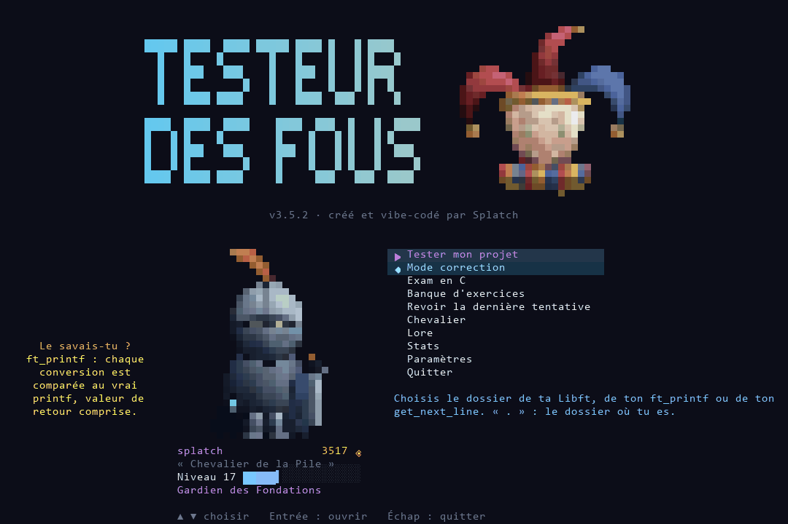
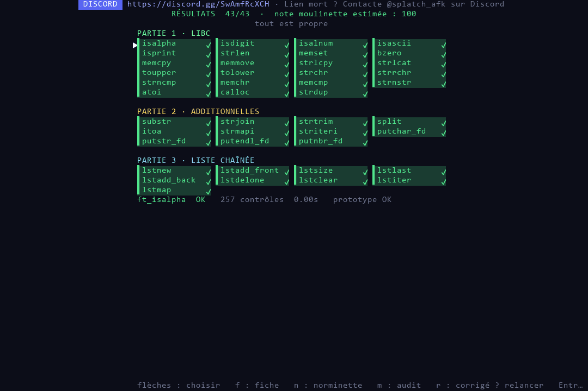
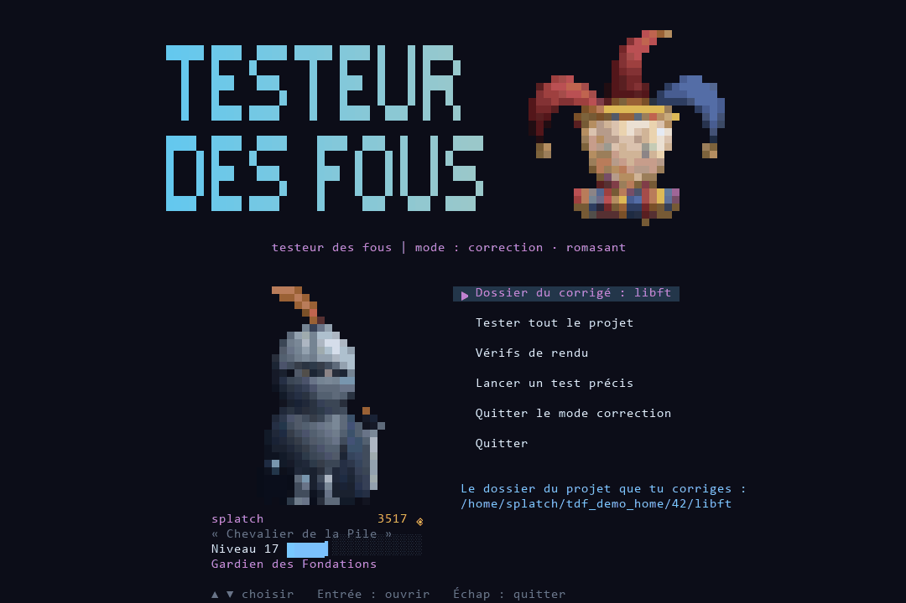

# Le testeur des fous

> **Version 3.5.1** · [nouveautés](docs/nouveautes/3.5.md) · [historique](CHANGELOG.md) · créé et vibe-codé par **Splatch** (`romasant`) pour les étudiants de 42 Next · projet étudiant non officiel.

**Un seul testeur pour Libft, ft_printf et get_next_line, un examshell en C, une banque d'exercices et un mode correction.** Il teste comme la moulinette, ne contient aucune solution et n'écrit rien à ta place : il casse ton code et te montre où regarder. Tout se fait aux flèches, dans un seul menu.

<p align="center"></p>

## Démarrer en 30 secondes

```bash
git clone https://github.com/SplatchAFK/testeur_des_fous.git   # à côté de tes projets, pas dedans
bash testeur_des_fous/run.sh
```

```text
ton_dossier/
├── testeur_des_fous/
├── libft/
├── ft_printf/
└── get_next_line/
```

Mets ton terminal en plein écran, choisis ta langue, suis le tuto (7 écrans, tu peux le passer). Il te faut seulement `bash`, `cc` et `make`, sans `sudo`. `norminette` et `valgrind` servent s'ils sont installés.

Astuce : Paramètres › « Installer la commande tdf », puis `tdf` suffit dans n'importe quel dossier. `tdf maj` met le testeur à jour. Tu as supprimé puis recloné le testeur ailleurs ? Paramètres › « Réinstaller la commande tdf ».

Après chaque mise à jour, Paramètres › « Nouveautés » montre ce qui a changé, page par page, avec un bouton pour y aller ([nouveautés de la 3.5](docs/nouveautes/3.5.md)).

## Tester ton projet

« Tester mon projet », puis « . » pour le dossier où tu es, Tab pour parcourir comme dans zsh, ou un des projets trouvés. Les résultats s'affichent tout de suite : Entrée sur une fonction ouvre un petit menu (fiche, norminette, audit de la moulinette, relancer les tests). « Revoir la dernière tentative » les rouvre plus tard.

<p align="center"></p>

| Projet | Ce qui est vérifié |
|---|---|
| Libft | 43 fonctions, prototypes comparés au sujet (.h et .c), includes, fuites et erreurs mémoire (ASan, UBSan, valgrind en option), Norme, Makefile (règles, relink, flags), fichiers parasites, fonctions interdites |
| ft_printf | chaque conversion, valeur de retour, `write` et `malloc` qui échouent, stress aléatoire, trace au format de la moulinette |
| get_next_line | 7 BUFFER_SIZE et sans `-D`, entrée standard, fd invalides, `read` et `malloc` qui échouent, fuites, Norme |
| push_swap | plus tard |

Le testeur compile ton projet comme la moulinette (`CFLAGS` imposés compris) et repère les fichiers qu'un `git add .` enverrait en trop.

**Options du test** (sous la liste des dossiers) : mode debug, audit complet, valgrind en plus, sans cinématiques, sans animations. Le mode debug affiche tous les rapports détaillés, avec une barre d'avancement et le temps restant.
## Mode correction

Tu corriges quelqu'un ? Le bouton bleu « Mode correction » du menu, ou directement :

```bash
tdf correction ../son_projet     # ou : bash testeur_des_fous/run.sh correction ../son_projet
```

Le testeur ne s'occupe plus que du dossier du corrigé, avec son login en haut de l'écran :

- **Tester tout le projet** : tous ses tests, sans cinématiques ni animations ;
- **Vérifs de rendu** : fichiers en trop, norminette, Makefile, fonctions interdites, en un seul écran ;
- **Lancer un test précis** : une fonction Libft, une catégorie ft_printf ou un BUFFER_SIZE, relancé seul avec tout le détail (pour la Libft, chaque cas testé).

Ses résultats ne comptent pas dans ta progression. Échap ramène au testeur normal.

<p align="center"></p>

## L'examshell des fous

Examen blanc de 3 h, série d'exercices ou entraînement libre, tout se règle aux flèches.

1. Lis le sujet dans `testeur_des_fous/exam/sujet/<exercice>/`.
2. Écris ton code dans `testeur_des_fous/exam/rendu/<exercice>/`, dans un autre terminal.
3. Dans l'examshell, tape `grademe`. Autres commandes : `sujet` (`sujet en`, `sujet es`…), `status`, `help`, `finish`.

La correction compile avec `cc -Wall -Wextra -Werror`, refuse les fonctions non autorisées, compare ta sortie octet par octet et signale les erreurs mémoire. Une commande mal tapée ? Le testeur propose la bonne.

## La banque d'exercices

94 exercices au choix, en 8 langues : 57 pour l'exam, 21 d'entraînement Libft, 16 d'entraînement printf. ◀ ▶ change d'onglet, Entrée ouvre le sujet, puis « Corriger mon code ».
## Ta progression

Chaque test réussi rapporte de l'expérience et des Octets. Dépense-les dans la boutique : 17 collections de tenues (dont le voyageur galactique) à essayer en entier, une recherche par nom (touche /), et un rayon Personnalisation qui change le testeur lui-même (couleurs du menu, curseur, emblème, teintures). Habille ton chevalier dans la garde-robe (il est animé, ça se coupe dans Paramètres › Réglages › Animations), suis tes courbes dans Stats, et découvre l'histoire de « la Cité qui compile » en pixel art (c'est un testeur, pas un jeu vidéo : tout se coupe dans les options).
Ta sauvegarde est dans `~/.testeur_des_fous/`, hors du dossier du testeur : tu peux le supprimer ou le recloner sans rien perdre.

## Le menu en bref

| Touche | Action |
|---|---|
| ↑ ↓ | choisir |
| Entrée | valider |
| ◀ ▶ | onglet ou réglage |
| / | rechercher un objet (boutique, garde-robe) |
| C | teindre l'objet porté (avec une teinture achetée) |
| Échap | revenir |

Langues : français, anglais, espagnol, allemand, italien, portugais, turc, russe (Paramètres › Réglages).

## Un problème ?

Active le mode debug (Tester mon projet › Options du test). Chaque lancement est noté dans `~/.testeur_des_fous/debug/` : envoie ce dossier sur Discord si tu bloques. Pendant une analyse, Échap ou Ctrl+C l'arrête.

## Discord

Serveur 42 Next Global (non officiel) · entraide, bugs, idées : [discord.gg/SwAmfRcXCH](https://discord.gg/SwAmfRcXCH) · lien mort ? Contacte **@splatch_afk** sur Discord.

## Crédits et licence

- Créé et vibe-codé par Splatch (`romasant`). Licence MIT, voir [LICENSE](LICENSE). Projet étudiant, sans lien officiel avec l'Association 42.
- Exam : la liste des 57 exercices vient de [42exam.net](https://42exam.net/) (rang 02) et de [Don't Panic](https://code-dontpanic.lovable.app/). Les énoncés sont réécrits avec nos mots. Idée de départ et première version de l'examshell : [exam_shell](https://github.com/Sam-Sepi00l/exam_shell) de Sam-Sepi00l, avec son accord.
- Mode série de l'exam et commande `tdf` : inspirés de [42-cli](https://github.com/brunogo25/42-cli) de Bruno Gomez.
- Moulinette, la vraie, est une chatte grise et libre.
