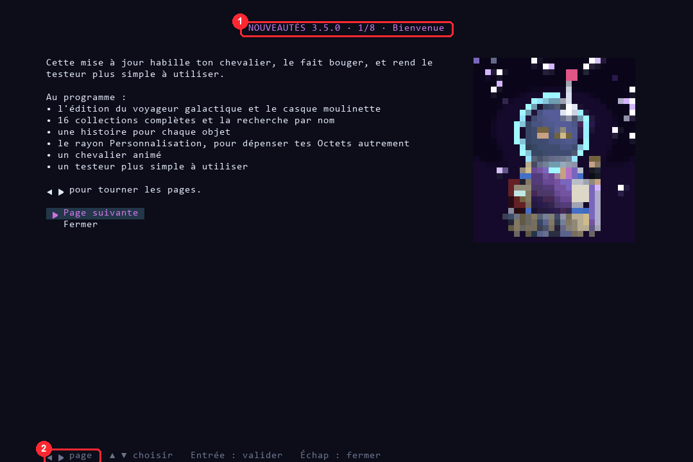
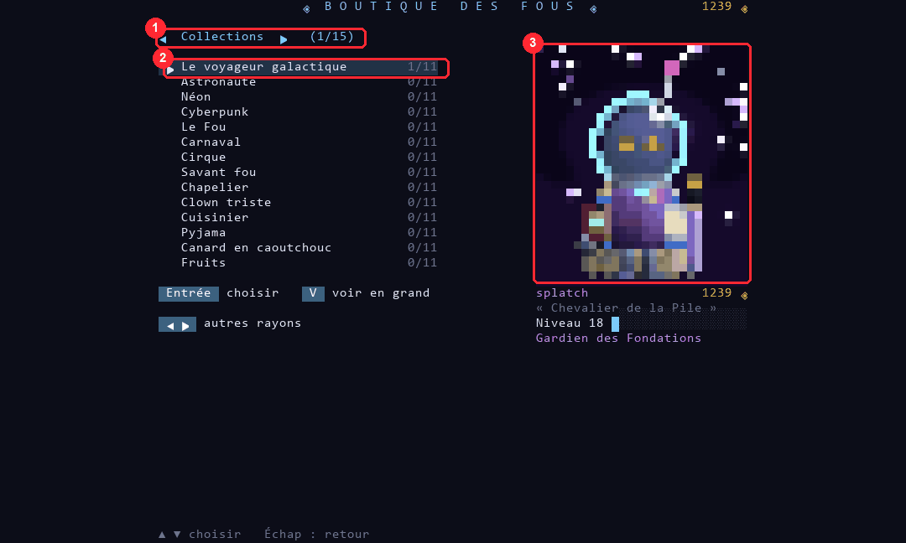
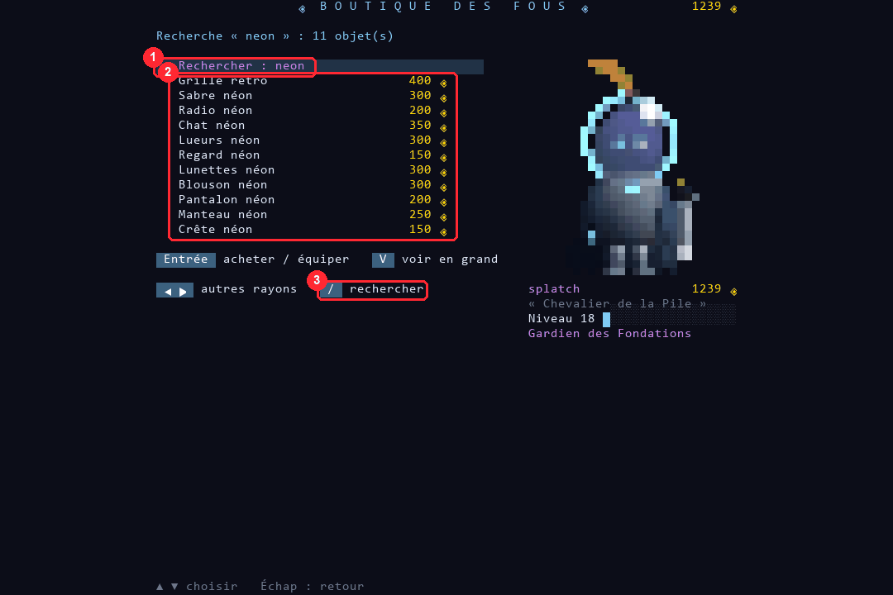
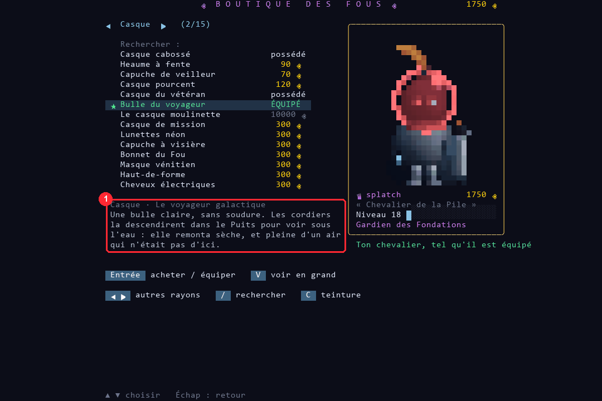
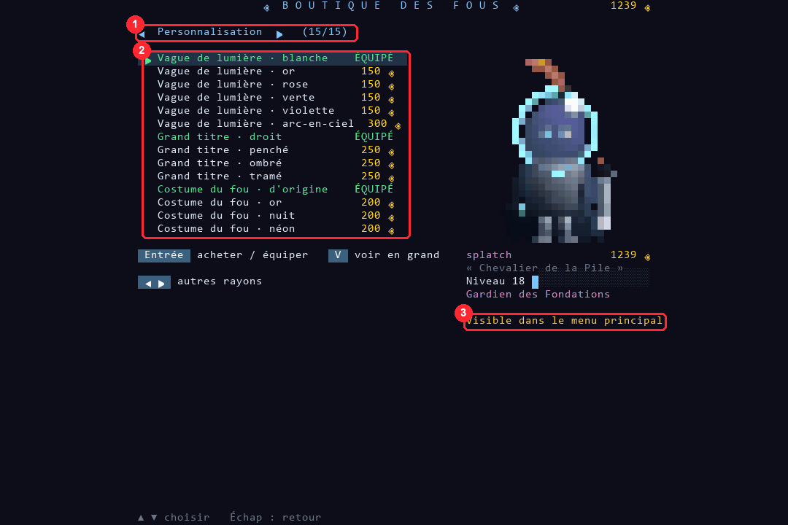
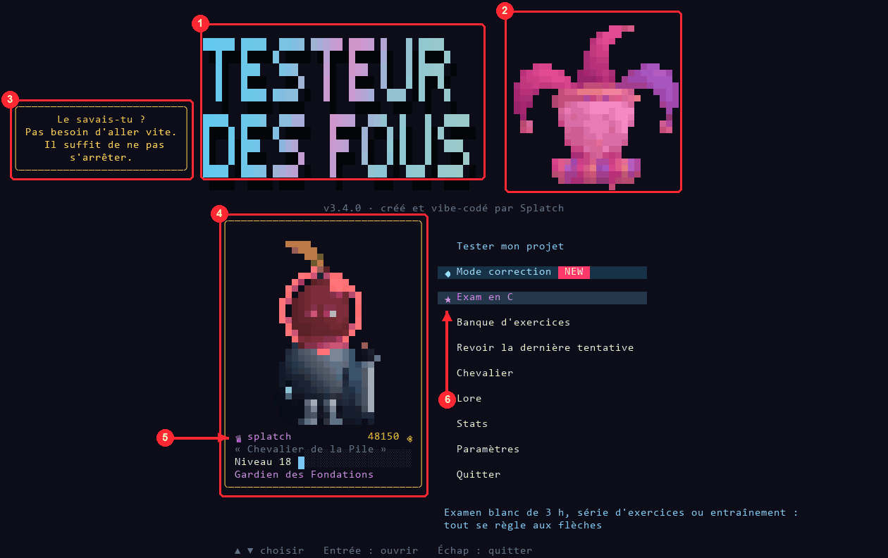
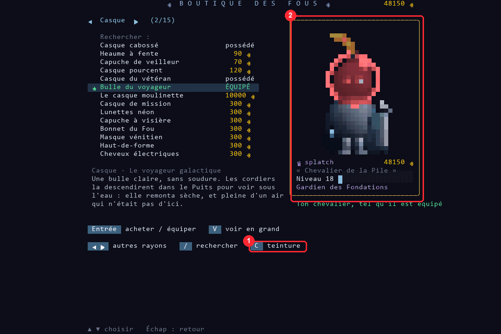
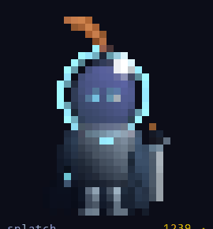

# Nouveautés de la 3.5

Cette mise à jour habille ton chevalier, le fait bouger, et rend le testeur plus simple à utiliser. Les mêmes pages existent dans le testeur : **Paramètres › Nouveautés** (◀ ▶ pour tourner les pages).

1. Le titre de la page et sa place (1/8 à 8/8).
2. ◀ ▶ pour passer d'une page à l'autre. Sur certaines pages, « Y aller » ouvre directement le bon rayon de la boutique.

---

## 1. Le voyageur galactique

Une édition rare de 11 pièces, de la bulle au familier, à 2 500 ◈ chacune. Et un objet unique : **le casque moulinette**, à 10 000 ◈.

**Mini tuto**

1. Menu principal › **Chevalier** › **Boutique**.
2. ◀ ▶ jusqu'au rayon **Collections** (1).
3. Choisis **Le voyageur galactique** (2) : la tenue complète s'affiche sur ton chevalier (3), même si tu ne l'as pas encore.
4. Entrée : **Acheter les pièces manquantes** ou **Porter toute la tenue**.

## 2. 16 collections et la recherche

Astronaute, Néon, Cyberpunk, le Fou, Carnaval, Cirque, Savant fou, Chapelier, Clown triste, Cuisinier, Pyjama, Canard en caoutchouc, Fruits, Carton et scotch, Mauvaise idée, Déguisement raté : 11 pièces chacune, à essayer en entier dans le rayon Collections.

**Mini tuto**

1. Dans la boutique ou la garde-robe, appuie sur **/** (3).
2. Tape une partie du nom (1) : « neon », « casque m », « canard ». Les accents ne comptent pas.
3. Les résultats viennent de tous les rayons (2). Entrée achète ou équipe, Échap revient à la liste normale.

## 3. Une histoire par objet

Chaque objet a son histoire, affichée sous la liste dans la boutique et la garde-robe. Toutes se passent pendant le Long Silence, avant l'arrivée de ton chevalier. Elles existent dans les 8 langues.

**Mini tuto**

1. Ouvre la boutique ou la garde-robe.
2. Descends sur n'importe quel objet : son emplacement, sa collection et son histoire s'affichent dessous (1).

## 4. Personnalisation

Un nouveau rayon de la boutique, pour dépenser tes Octets autrement que pour les tenues : il change le testeur lui-même.

| Option | Choix | Prix |
|---|---|---|
| Vague de lumière du menu | or, rose, verte, violette, arc-en-ciel | 150 ◈ (arc-en-ciel 300 ◈) |
| Grand titre | penché, ombré, tramé | 250 ◈ |
| Costume du fou | or, nuit, néon, givre | 200 ◈ |
| Cadre des bulles « Le savais-tu ? » | doré, cyan, rose | 120 ◈ |
| Curseur de sélection | ◆ ★ ➤ ● ♦ | 80 ◈ |
| Emblème devant ton login | ★ ♛ ☾ ✿ ♞ ♥ | 100 ◈ |
| Cadre du profil | or, cyan, rose | 150 ◈ |
| Teintures | rouge, bleue, verte, or, violette, noire | 200 ◈ |
| Emplacements de tenues | du 6e au 10e, dans l'ordre | 300 ◈ |

**Mini tuto**

1. Chevalier › Boutique, puis ◀ ▶ jusqu'au rayon **Personnalisation** (1).
2. Descends sur une option (2) : Entrée l'achète, puis Entrée la choisit. « Visible dans le menu principal » (3) te dit où regarder.
3. Reviens au menu principal : le résultat est là.

Le menu ci-dessus avec : titre ombré et vague rose (1), fou néon (2), bulles au cadre doré (3), cadre du profil or (4), emblème ♛ (5), curseur ★ (6).

### Teintures

1. Achète au moins une teinture dans le rayon Personnalisation.
2. Va sur un objet que tu portes : le bouton **C teinture** apparaît (1).
3. Appuie sur **C** : l'objet prend la couleur (2). Appuie encore pour passer à la teinture suivante, jusqu'à revenir à la couleur d'origine.

## 5. Ton chevalier est animé

Dans le menu, la garde-robe et la boutique, ton chevalier respire, sa cape ondule, ses yeux clignent et son familier flotte.

C'est léger : 5 images par seconde au plus, et seules les cases qui changent sont redessinées. Pour couper : **Paramètres › Réglages › Animations › « aucune »**.

## 6. Plus simple à utiliser

- **Résultats Libft et ft_printf** : Entrée ouvre un petit menu près de la fonction (fiche, norminette, audit, relancer les tests, continuer). Les touches f, n, m et r marchent toujours.
- **Paramètres** tient en entier dans un terminal de 80x24.
- **La touche q** ne quitte plus par erreur : Échap revient en arrière partout, Ctrl+C quitte l'écran « Agrandis ton terminal ».
- **La commande tdf** ne marche plus après avoir supprimé et recloné le testeur ? Paramètres › **Réinstaller la commande tdf**.
- Un fou s'est glissé dans les bulles « Le savais-tu ? ». Ouvre l'œil.

---

Une idée, un bug, une question ? Viens sur le [serveur Discord](https://discord.gg/SwAmfRcXCH).
